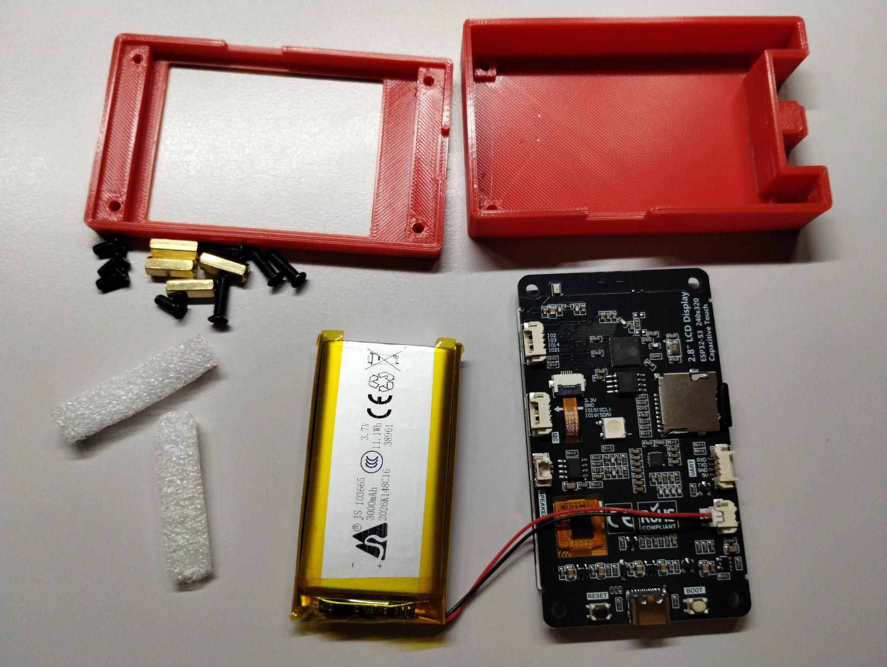
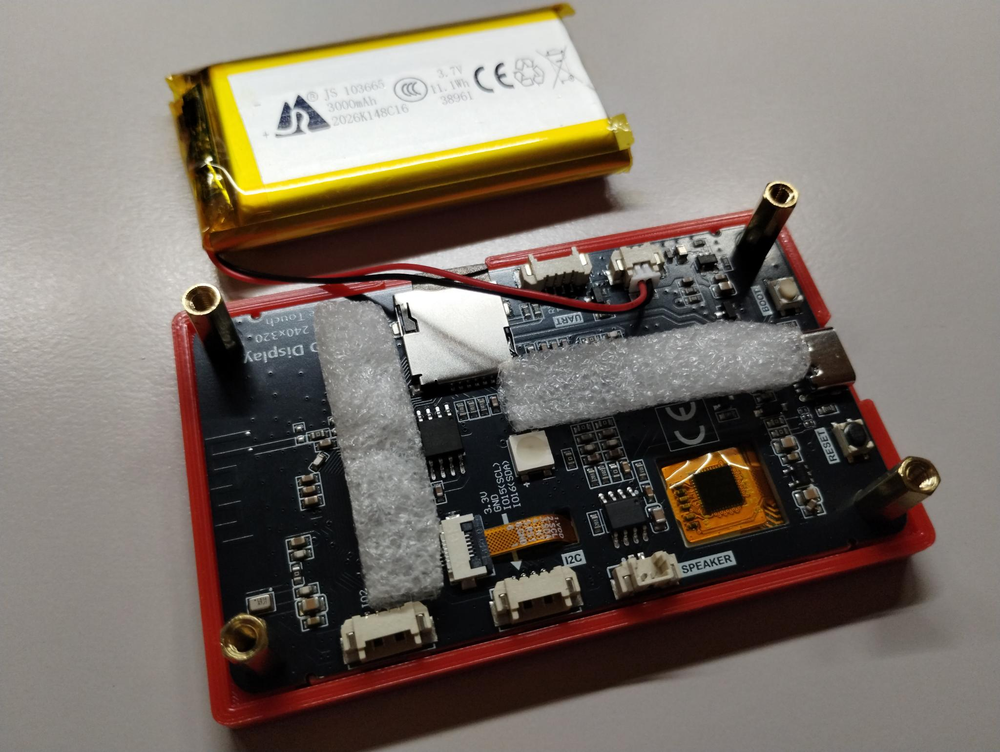
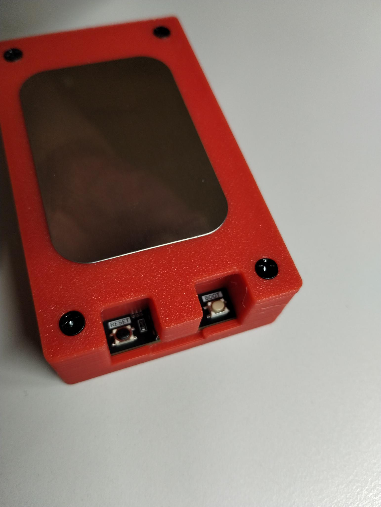
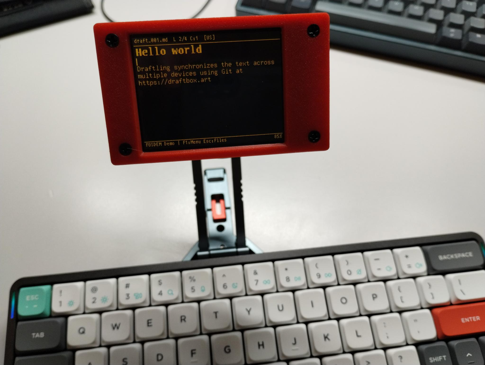

# Enclosure for Freenove FNK0104A and FNK0104B   

[Freenove FNK0104A and
FNK0104B](https://github.com/Freenove/Freenove_ESP32_S3_Display) are
two ESP32-S3 boards with a 2.8" 320x240 LCD screen. The B model comes
with a touchscreen. Draftling firmware supports both and this
enclosure works for both boards too.

This enclosure consists of two 3d-printed parts, tied together by 8 M3
screws and 4 spacers. Inside there's a pocket for a LiPo battery up to
10mm thick, such as 103450 or 103665. The biggest battery that would fit
is the 104070 type). JST 1.25mm 2-pin plug should be used for the
battery. A 3000mAh battery would provide for over 10 hours uptime
at 50% brighness.

One or two small pieces of the packaging foam are recommended between
the board and the battery in order to fixate it and reduce the
vibrations.

Part list:

* M3*12mm countersunk head screws: 4 pc
* M3*8mm countersunk head screws: 4 pc
* M3 female-female 12mm spacers: 4 pc
* a piece of packaging foam

Printed parts: PLA, 0.2mm, 20% infill.

