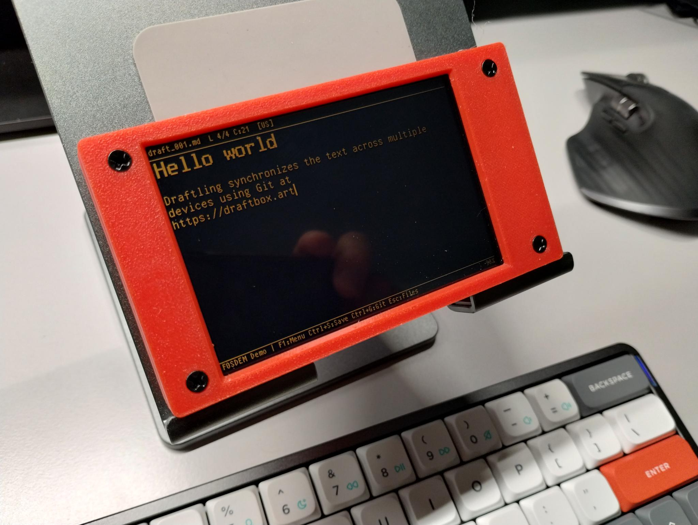
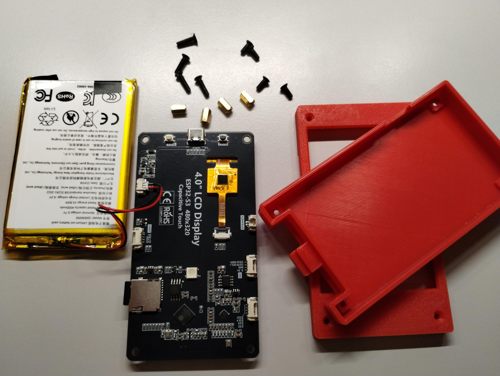
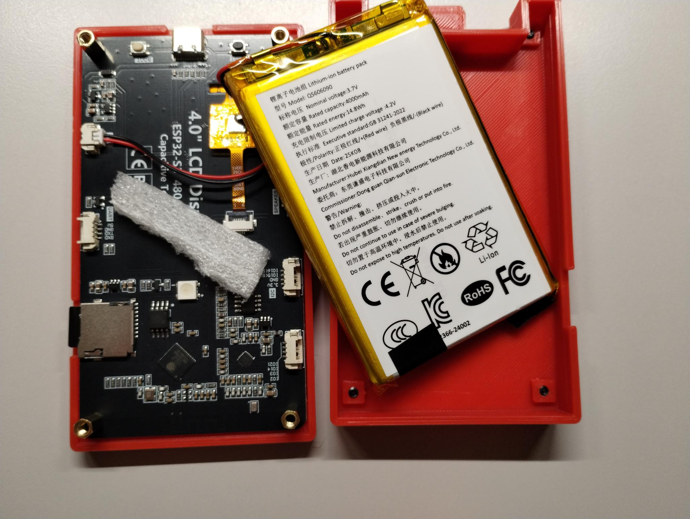
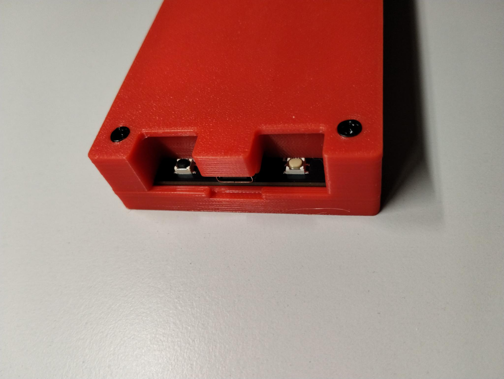

# Enclosure for Freenove FNK0104S

[Freenove
FNK0104S](https://github.com/Freenove/Freenove_ESP32_S3_Display) is an
ESP32-S3 booard with a 4" 480x320 LCD screen.

This enclosure consists of two 3d-printed parts, tied together by 8 M3
screws and 4 spacers. Inside there's a pocket for a battery (606090
type was used, but other types would fit too).

Also, a small piece of the packaging foam is recommended between the
board and the battery in order to fixate it and reduce the vibrations.

Part list:

* M3*12mm countersunk head screws: 4 pc
* M3*8mm countersunk head screws: 4 pc
* M3 female-female 8mm spacers: 4 pc
* a piece of packaging foam

Printed parts: PLA, 0.2mm, 20% infill.

