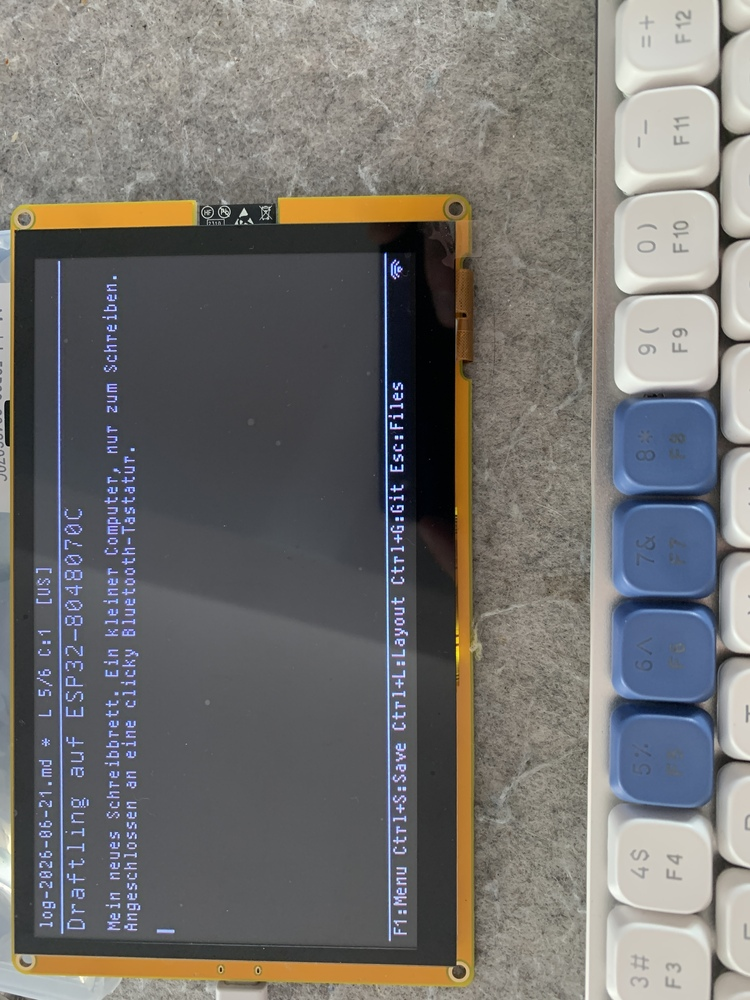

# Sunton ESP32-8048S043C and ESP32-8048S070C

Two ESP32-S3 HMI development boards with the same design in two sizes:

| | ESP32-8048S043C | ESP32-8048S070C |
| --- | --- | --- |
| Display | 4.3" 800x480 IPS (ST7262) | 7" 800x480 TN |
| Build preset | `sunton_8048s043` | `sunton_8048s070` |
| Touch | GT911, on by default | GT911, off by default (enable `DRAFTLING_TOUCHSCREEN` in menuconfig) |
| USB-C and MicroSD | opposite edge to the 7" board | |

Common to both:

- ESP32-S3, 16 MB flash (wired for DIO mode), 8 MB octal PSRAM at
  80 MHz.
- Panel on the 16-bit parallel RGB565 interface, driven by the
  ESP32-S3 LCD peripheral from a framebuffer in PSRAM. Rendered at the
  full 800x480 with the larger Hack font.
- Backlight on GPIO2, dimmable (LEDC PWM).
- GT911 capacitive touch on I2C. Its INT line is not wired, so the
  controller is polled, and it may answer at either of its two
  addresses (0x5D or 0x14).
- MicroSD on SPI.
- BOOT button (GPIO0) wakes from deep sleep; hold it 2 s to forget the
  paired keyboards.
- No battery input or monitor. USB goes through a USB-to-UART bridge,
  so "SD card via USB" and "Sync via browser" are not available.

References:

- rzeldent / platformio-espressif32-sunton board definitions:
  https://github.com/rzeldent/platformio-espressif32-sunton
- LovyanGFX config for the 7" board (Harald Kreuzer):
  https://www.haraldkreuzer.net/aktuelles/erste-schritte-mit-dem-sunton-esp32-s3-7-zoll-display-lovyangfx-und-lvgl
- Makerfabs product page (7"):
  https://www.makerfabs.com/sunton-esp32-s3-7-inch-tn-display-with-touch.html

## Panel wiring and timings

The two boards differ only in the panel wiring and timings:

| Parameter          | S043C (4.3")   | S070C (7")     |
| ------------------ | -------------- | -------------- |
| PCLK               | 12.5 MHz       | 12 MHz         |
| HSYNC GPIO         | 39             | 39             |
| VSYNC GPIO         | 41             | 40             |
| DE GPIO            | 40             | 41             |
| PCLK GPIO          | 42             | 42             |
| DISP GPIO          | not wired      | not wired      |
| HSYNC pw/bp/fp     | 4 / 8 / 8      | 2 / 43 / 8     |
| VSYNC pw/bp/fp     | 4 / 8 / 8      | 2 / 12 / 8     |
| PCLK active edge   | negative       | positive       |
| PCLK idle level    | low            | high           |

VSYNC and DE are swapped between the boards. On the 7" board, PCLK
rates above 12 MHz flicker under CPU load.

Data lines, from the RGB565 least-significant bit (bit 0) up:

| Bits   | S043C               | S070C               |
| ------ | ------------------- | ------------------- |
| 0..4   | 8, 3, 46, 9, 1      | 15, 7, 6, 5, 4      |
| 5..10  | 5, 6, 7, 15, 16, 4  | 9, 46, 3, 8, 16, 1  |
| 11..15 | 45, 48, 47, 21, 14  | 14, 21, 47, 48, 45  |

On the 7" board the lines are physically R, G, B but must be given to
the ESP32-S3 in B, G, R order; in R, G, B order red and blue came out
swapped. The 4.3" board needs R, G, B order.

## Other pins

Identical on both boards:

| Function        | GPIO |
| --------------- | ---- |
| SD CS           | 10 |
| SD MOSI         | 11 |
| SD MISO         | 13 |
| SD SCK          | 12 |
| Touch I2C SDA   | 19 |
| Touch I2C SCL   | 20 |
| Touch RST       | 38 |
| Touch INT       | not wired |
| Backlight       | 2 |
| Wake (BOOT)     | 0 |

The touch panel is natively landscape 800x480: no axis swap or mirror.

## Mounting

On the 4.3" board the USB-C connector and the MicroSD slot are on the
opposite edge from the 7" board, so depending on how the board is
mounted the picture may need turning: F1 -> Settings -> Display ->
Rotate 180 does that at once, without a restart.
